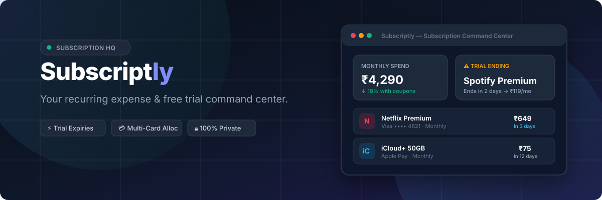

<p align="center">
  
</p>

<p align="center">
  
  
</p>

<p align="center">
  <b>The modern, privacy-first personal subscription command center.</b><br />
  Know what you pay, when free trials convert to paid plans, which card will be charged, and where to cut costs.
</p>

<p align="center">
  <a href="https://subscriptly-topaz.vercel.app"></a>
  <a href="https://github.com/sarthak7gupta/subscriptly/actions/workflows/ci.yml"></a>
  
  
  
  
  <a href="./LICENSE"></a>
  
</p>

---

## ⚡ The Problem

Consumers subscribe to dozens of recurring services across streaming, software, cloud storage, fitness, and news. Most people lose control because:

1. **Forgotten Free Trials:** Trials silently convert into full-price annual or monthly charges.
2. **Invisible Price Jumps:** 50% introductory discounts expire without warning.
3. **Card Fragmentation:** Charges bounce or hit obsolete cards because no single app tracks card-to-merchant allocations.
4. **Billing Cadence Confusion:** Monthly, quarterly, semi-annual, and annual plans make estimating real burn rates deceptive.
5. **Data Insecurity:** Most finance apps demand your bank login credentials or sell transaction data to ad brokers.

**Subscriptly fixes all of this.**

---

## ✨ Key Features

### 1. 🎯 Unified Subscription Command Center
- **True Monthly & Annual Equivalent Cost:** Normalizes weekly, monthly, quarterly, semi-annual, and annual plans into a single financial truth.
- **Smart Recommendations:** Proactively alerts you to trials ending within 7 days, duplicate subscription names, unassigned cards, and expired payment methods.
- **Visual Category Breakdown:** Real-time distribution progress meters across 12 distinct lifestyle categories.

### 2. ⏳ Free Trial & Deal Tracker
- **Expiration Countdown:** Monitors exact trial and coupon expiry dates (`In 2 days`, `In 14 days`, `Overdue`).
- **Post-Promo Regular Price Tracking:** Know the exact price jump before it happens.
- **One-Click Coupon Copier:** Store promo codes (`BINGE150`, `SUMMER50`) and copy them to the clipboard in one click.
- **Total Savings Calculator:** Calculates how much money your discounts and trials actually save you annually.

### 3. 💳 Multi-Card & Wallet Allocator
- **Visual Card Stacks:** Realistic card skins with EMV chip styling for Visa, Mastercard, Amex, RuPay, UPI, and Apple ID billing.
- **Card Spend Auditing:** See the exact monthly recurring liability attached to each card or bank account.
- **Card Expiry Warning:** Highlights cards expired or expiring this month so recurring renewals won't fail unexpectedly.
- **Zero Full Card Numbers:** Strictly stores nicknames and last 4 digits. Zero sensitive card data.

### 4. 📅 Renewal Timeline & Calendar
- **Interactive Windows:** Filter by Next 7, 30, 60, or 90 days.
- **Chronological Day Badges:** Clear calendar date cards with upcoming due labels.
- **One-Click Renewal Advance:** Mark a charge as paid to advance its next billing date by the appropriate cadence cycle.

### 5. 📊 Deep Spending Insights & Optimization
- **Monthly vs Annual Projections:** Compare 30-day burn rates against 12-month financial commitments.
- **Annual Billing Switch Simulator:** Projects potential ~15% annual savings if converting eligible monthly SaaS plans to annual upfront billing.
- **Free Trial Liability Exposure:** Calculates total annual spend at risk if active trials convert to full price.

### 6. 🔒 100% Private & Portable
- **Offline-First:** All records stay encrypted in your browser's `localStorage`. No server database, no cookies, no tracking.
- **Full JSON Backup & Restore:** Complete schema validation and error reporting.
- **One-Click CSV Export:** Ready for spreadsheet analysis in Excel or Google Sheets.

---

## 🛠 Tech Architecture

Subscriptly is engineered with a modern static-first architecture:

```
subscriptly/
├── .github/
│   └── workflows/ci.yml     # Automated CI (Vitest suite & Astro build)
├── public/
│   └── assets/              # SVG brand marks, logo, banners, and favicon
├── src/
│   ├── components/          # Reactive Svelte 5 components
│   │   ├── App.svelte       # Master workspace shell and modal orchestrator
│   │   ├── Sidebar.svelte   # Responsive navigation and workspace switcher
│   │   ├── Header.svelte    # Quick search, currency switcher, and theme toggle
│   │   ├── OverviewView.svelte
│   │   ├── SubscriptionsView.svelte
│   │   ├── CalendarView.svelte
│   │   ├── PaymentsView.svelte
│   │   ├── OffersView.svelte
│   │   ├── InsightsView.svelte
│   │   ├── SettingsView.svelte
│   │   ├── SubscriptionModal.svelte
│   │   ├── PaymentModal.svelte
│   │   ├── DeleteConfirmModal.svelte
│   │   ├── Toast.svelte
│   │   └── layouts/
│   │       └── UnifiedCockpitLayout.svelte # Bento widgets + Card filters + Swiss inspector
│   ├── layouts/
│   │   └── Layout.astro     # SSR static shell with instant dark-mode script
│   ├── lib/
│   │   ├── calculations.ts  # Pure domain math, cadences, savings, and dates
│   │   ├── storage.ts       # LocalStorage repository, backup JSON/CSV
│   │   ├── store.ts         # Reactive Svelte state stores and actions
│   │   └── types.ts         # TypeScript domain contracts
│   └── pages/
│       └── index.astro      # Static island entry point
└── tests/                   # Automated Vitest unit tests
    ├── calculations.test.ts
    └── storage.test.ts
```

---

## 🚀 Getting Started

### Prerequisites
- Node.js 18+ (tested on Node v24)
- npm or bun

### Installation

```bash
# Clone the repository
git clone https://github.com/sarthak7gupta/subscriptly.git
cd subscriptly

# Install dependencies
npm install

# Start the local development server
npm run dev

# Or build and run production preview
npm run build
npm run preview
```

Open [http://localhost:4321](http://localhost:4321) in your browser.

---

## 🧪 Testing

Subscriptly includes unit test coverage for domain calculations, cadence conversion, savings algorithms, and JSON backup schema validation using [Vitest](https://vitest.dev/):

```bash
# Run tests
npm test

# Run tests in watch mode
npm run test:watch
```

---

## 💡 Suggested Future Features

Based on product analysis, the following features are great candidates for future iterations:

- [ ] **Push / Web Notification Reminders:** Native browser notifications 3 days before a free trial converts.
- [ ] **iCal / Google Calendar Feed:** Export a live `.ics` subscription renewal calendar subscription.
- [ ] **Multi-Currency Conversion Engine:** Real-time exchange rate normalization for international SaaS (e.g. paying USD for ChatGPT and INR for Netflix).
- [ ] **Cancellation Assistant / Direct Links:** Store direct cancellation URL and retention guidance for top 100 popular services.
- [ ] **Household / Family Sharing Sync:** End-to-end encrypted WebRTC or Peer-to-Peer synchronization across household devices.

---

## 📄 License

MIT License. Free to use, modify, and distribute.
